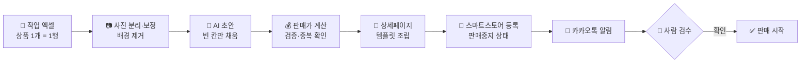

<div align="center">

# 🛍️ SmartStore 상품 등록 자동화

**엑셀 한 줄과 사진만 넣으면, 네이버 스마트스토어 등록까지 알아서.**

사진 정리 · 보정 · 배경 제거 → AI 초안 → 판매가 계산 → 상세페이지 조립 → **판매중지 상태로 안전하게 등록** → 카카오톡 알림


[📦 실행 파일 받기](../../releases) · [📖 사용법](smartstore_app/사용법.md) · [🎤 발표 자료](docs/)

</div>

---

## ✨ 한눈에 보기

판매자가 하던 반복 작업을 앱이 대신합니다. 사람은 **엑셀 입력 → 검수 → 판매 시작**만 하면 됩니다.



### 실제 등록 결과

| 상품 | 등록 방법 | 링크 |
|---|---|---|
| L001 꽈배기 니트 | Claude가 이 앱을 사용해 등록 | [스토어에서 보기 →](https://smartstore.naver.com/luminarko/products/13847880378) |
| L002 코듀로이 후드 | 사용 가이드 9단계를 그대로 따라 앱으로 등록 | [스토어에서 보기 →](https://smartstore.naver.com/luminarko/products/13848258078) |

---

## 🧰 주요 기능

| 영역 | 기능 |
|---|---|
| **상품 등록** | 단일 상품 등록, 조합형 옵션(최대 3그룹) 자동 조합표, 배송·반품·A/S·고시 템플릿, 임시저장 |
| **엑셀 자동화** | 작업 엑셀 한 행 = 상품 1개, 분류 매핑(네이버 카테고리·마진율·상품명 규칙), 결과를 같은 행에 기록 |
| **판매가 계산** | `원가 × (1 + 마진) ÷ (1 − 수수료)` → 올림 → 끝자리 정리(예: 18,900원) |
| **사진** | QR 카드로 촬영 사진 자동 분리, HEIC 지원, 1000×1000 보정, 화이트밸런스, AI 배경 제거(BiRefNet) |
| **AI 초안** | Claude가 사진을 보고 상품명·설명·검색 태그 후보 작성 — **비어 있는 칸만** 채움 |
| **상세페이지** | Jinja2 HTML 템플릿(에디토리얼 · 심플 · 이미지만), 미리보기 후 등록 |
| **상품 관리** | 스토어 상품 조회·필터, 가격·재고·옵션·판매 상태 수정, 일괄 상태 변경, 검수 대기 탭 |
| **예약 · 알림** | Windows 작업 스케줄러로 정해진 시간에 자동 실행, 카카오톡 '나에게 보내기'로 결과 요약 |
| **명령줄** | `SmartStoreCli.exe run · draft · publish · preview · sort-photos · schedule …` 로 화면 없이 실행 |

---

## 🔒 안전 원칙

자동화가 실수해도 손님에게 바로 보이지 않도록 설계했습니다.

- **판매중지로 등록** — 사람이 검수하고 '판매 시작'을 눌러야 판매됩니다.
- **사람이 입력한 값은 덮어쓰지 않음** — AI 초안은 비어 있는 칸만 채웁니다.
- **원본 사진은 수정·삭제하지 않음** — 보정본은 별도 폴더에 만듭니다.
- **중복 3중 확인** — 같은 엑셀 · 앱 등록 기록 · 스토어 판매자 상품코드.
- **하루 등록 한도** — 넘는 상품은 '대기'로 두고 다음 실행 때 처리합니다.
- **키는 keyring에만** — 커머스 API 시크릿 · Claude API 키 · 카카오 토큰은 Windows 자격 증명 관리자에만 저장하고, 코드·설정·로그에 남기지 않습니다.

---

## 🚀 시작하기

### 실행 파일로 쓰기 (추천)

1. [Releases](../../releases)에서 zip을 받아 압축을 풉니다.
2. `SmartStoreApp\SmartStoreApp.exe`를 실행합니다. **폴더째로** 두고 써야 합니다.
3. **설정**에서 커머스API 애플리케이션 ID·시크릿을 입력하고 연결 테스트를 합니다.
   (커머스API센터에 이 PC의 공인 IP가 등록되어 있어야 합니다.)

자세한 사용 순서는 [사용법](smartstore_app/사용법.md)을 참고하세요.

### 소스로 실행하기

```powershell
python -m venv .venv
.venv\Scripts\python -m pip install -r smartstore_app\requirements.txt
cd smartstore_app
..\.venv\Scripts\python main.py        # 또는 run.bat
```

```powershell
..\.venv\Scripts\python -m pytest -q   # 테스트 205개 (실제 API·네트워크는 차단된 상태로 실행)
build.bat                              # dist\SmartStoreApp\ 에 exe 빌드 (build.bat lite: 배경 제거 제외)
```

---

## 🗂️ 프로젝트 구조

```
├─ docs/                    발표 PPT
├─ 발표대본_최종.txt
└─ smartstore_app/
   ├─ main.py · cli.py      화면 앱 / 명령줄 진입점
   ├─ api/                  네이버 커머스 API (인증·상품·카테고리·이미지)
   ├─ services/
   │  ├─ automation/        작업 엑셀 · 가격 · 상품명 · 파이프라인 · 검수
   │  ├─ images/            사진 분리(QR) · 보정 · 배경 제거 · 다운로드
   │  ├─ notify/            카카오톡 알림
   │  ├─ ai_draft.py        Claude AI 초안
   │  └─ detail_page.py     상세페이지 조립
   ├─ storage/              SQLite DB · keyring 자격 증명
   ├─ ui/                   PySide6 화면
   ├─ resources/            스타일 · 상세 템플릿 · 입력 양식
   └─ tests/                pytest 205개
```

## 🛠️ 기술 스택

**Python 3.14** · PySide6 · SQLite · keyring · requests · openpyxl · Pillow(HEIC) · rembg(BiRefNet) · zxing-cpp/qrcode · Jinja2 · Anthropic Claude API · Kakao API · PyInstaller

---

## 📅 만든 과정

| 날짜 | 내용 |
|---|---|
| **Day 1** (10/29) | 네이버 커머스 API 발급, 상품 등록 앱 1차 완성 — 등록 · 옵션 · 관리 · 엑셀 · exe |
| **Day 2** (11/2) | 자동화 설계 프롬프트 작성, 9단계 순서대로 구현 — 엑셀 파이프라인 · 사진 보정 · 상세페이지 · 검수 · 알림 · QR · AI 초안 · 배포 |
| **Day 3** (11/3) | 실제로 써 보며 기능 추가 · 버그 수정, 실제 상품 등록, 사용 가이드 작성 |

<div align="center">
<sub>Built with <a href="https://claude.com/claude-code">Claude Code</a></sub>
</div>
